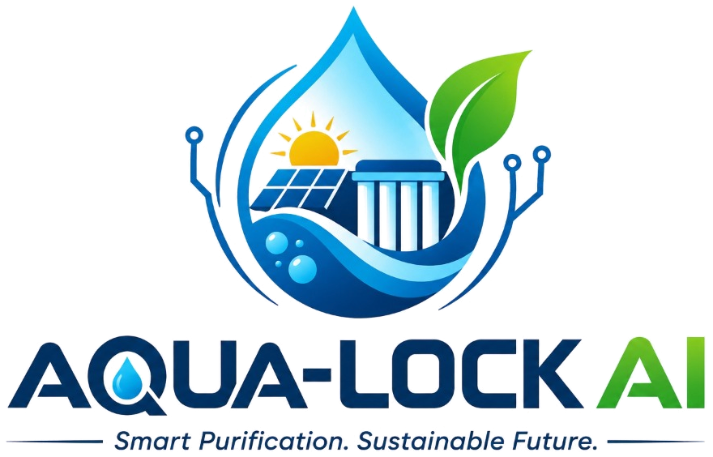

<p align="center">
  
</p>

Conversation Log
# AQUA-LOCK AI — Simulator Dashboard (IDTC 2.0 AIoT)

Simulasi web React untuk demo prototipe Fase 2: klaster 4 kolam, Safety Interlock,
FSM 3 status, model XGBoost risiko amonia, kalibrasi terpandu, dan aliran MQTT.

## Menjalankan

```bash
npm install
npm run dev        # buka http://localhost:5173
npm run build      # hasil: dist/index.html (1 file, bisa dibuka offline tanpa server)
```

Melatih ulang model (opsional):

```bash
pip install xgboost scikit-learn pandas
npm run dataset    # node ml/generate_dataset.mjs → ml/dataset.csv
npm run train      # python3 ml/train_xgboost.py → src/sim/xgb_model.js
node ml/cek_model_js.mjs   # pastikan hasil JS = Python
```

## Struktur & isi tiap file

| File | Isi | Bab PRD |
|---|---|---|
| `src/sim/constants.js` | Profil multi-komoditas (default Udang + Nila, Lele, Patin) & ambang simulasi | F2, F3, F4, Bab 7 & 9 |
| `src/sim/chemistry.js` | Rumus Emerson (fraksi NH3), pola harian, kalibrasi pH `pH = m·V + c`, kompensasi TDS `V/(1+0,02(T−25))`, regresi linear | Bab 6 |
| `src/sim/model.js` | Inference XGBoost di JavaScript (jumlah nilai daun → sigmoid) | F2 |
| `src/sim/ai.js` | Fitur, risiko NH3, porsi 100/50/0%, prediksi pH 30 mnt, deteksi anomali & data datar, durasi dosing | F2, F5 |
| `src/sim/engine.js` | Fisika air, Sequential Reading, FSM, Safety Interlock, jeda booting 30 dtk, watchdog, tangki POC, MQTT, skenario | F1, F3, F4, Bab 9 |
| `src/twin/Scene3D.js` | Digital twin 3D (three.js): kolam, node, feeder, pipa drain/inlet, tangki POC, gateway, hujan, siang–malam. Dibaca langsung dari simulator tiap frame | F6 |
| `src/twin/Panel.jsx` | Panel kanan bagian 1–8 | F6 |
| `src/twin/konten.js` | Teks bagian & naskah tur 2 menit adaptif Si Aqua | – |
| `src/twin/Maskot.jsx` | Maskot hybrid Si Aqua (muka lele berkumis + badan udang + buntut ikan, SVG) | – |
| `src/ui/*` | Komponen: OLED, FSM, grafik, skenario, kalibrasi, model, arsitektur | F6 |
| `ml/generate_dataset.mjs` | Dataset sintetis 120 hari dari simulator | Sprint 2 |
| `ml/train_xgboost.py` | Latih + evaluasi (split waktu 80/20) + ekspor pohon | Sprint 2 |

## Shortcut saat demo

`T` tur 2 menit · `Enter` jelajah · `L` timelapse 24 jam · `H` bersihkan layar · `Spasi` jeda ·
`1`–`8` buka bagian · `←/→` langkah tur · `Esc` tutup.

## Alur data

1. **ESP32 node** membaca sensor berurutan: MOSFET TDS ON → stabil → baca TDS → MOSFET OFF → jeda → baca pH → baca suhu (`bacaSensor`).
2. Tiap 30 detik node publish JSON ke `aqualock/kolam{n}/sensor` (MQTT QoS 1).
3. **MPU Linux** (Uno Q) menghitung 6 fitur → XGBoost → risiko NH3 → porsi (`evaluasiAI`).
4. **FSM** memutuskan status (`langkahFsm`): NORMAL / CLEANING / PH_RECOVERY, debounce 2 evaluasi.
5. Perintah dikirim ke `aqualock/kolam{n}/cmd`; `feed_lock` disimpan di MPU, STM32, dan ESP32.
6. Tombol Manual Feed saat terkunci → ditolak, servo diam, buzzer bunyi (`tekanPakanManual`).

## Hasil model (data uji 20% hari terakhir)

Lihat tab **Model AI** atau `src/sim/xgb_model.js` → `metrik`. Pada versi ini F1 = 0,887
(target PRD ≥ 0,88), precision 0,925, recall 0,853.

## Penyesuaian dibanding PRD v1.0

- **Fitur ke-6 `pakan_6j`**: pakan 6 jam terakhir dari log servo (Business Case §4 menyebut
  “riwayat pakan”, tetapi F2 hanya menulis 5 fitur). Menaikkan F1 validasi.
- **Tindakan berdasarkan penyebab**: risiko NH3 ≥ 0,70 dengan pH > 7,8 → PH_RECOVERY
  (turunkan pH) dulu, bukan kuras. Fraksi NH3 bebas sangat bergantung pH, jadi kuras 15%
  hampir tidak menolong saat penyebabnya pH tinggi (mis. ledakan alga).
- **Histeresis**: keluar PH_RECOVERY saat pH 6,7–8,0 agar status tidak bolak-balik.
- **Tangki POC**: default IBC 1.000 L. Drum 200 L hanya muat ±⅓ volume sekali kuras
  (kolam Ø3 m, air 60 cm, 15% ≈ 636 L). Bisa dipilih di panel tangki.
- Dashboard dibuat dengan React (PRD menyebut Streamlit).

tolong perbaiki readme ini sesuai dengan projek

README.md telah diperbarui agar sesuai dengan kondisi proyek di aqualock-ai/.

Ringkasan pembaruan di README.md

Gambaran & Tampilan Utama:

Menjelaskan tiga mode 3D pada App.jsx dan NodeView.jsx: Kolam 3D (tampilan awal, SceneKolam.jsx + mode X-Ray GPIO), Skematik 3D Wokwi (SceneSkematik.jsx, 25 komponen & 58 koneksi dari diagram.json), dan Klaster 4 Kolam (Scene3D.js).
Menambahkan dokumentasi Mode Multi-Komoditas (default Udang, plus Nila, Lele, Patin) beserta jeda BOOTING 30 detik & tombol Skip Booting, tab Model AI & Arsitektur & MQTT, serta asisten remote control Si Aqua Bot (Chatbot.jsx, botEngine.js).

Perintah Menjalankan, ML & Wokwi:

Menambahkan langkah cd aqualock-ai (karena package.json berada di subdirektori aqualock-ai/), npm run preview, catatan python di Windows untuk train_xgboost.py, catatan ketergantungan ml/sampel_uji.csv untuk cek_model_js.mjs, perintah uji CLI uji_dinamika.mjs, serta bagian simulasi/firmware wokwi/.

Tabel Struktur & Isi File:

Melengkapi daftar file yang sebelumnya belum tercantum: App.jsx, xgb_model.js, seluruh modul src/node/* (firmware.js, NodeView.jsx, SceneKolam.jsx, SceneSkematik.jsx, PanelNode.jsx, komponen.js, oled.js, bagian3d.jsx), Chatbot.jsx & botEngine.js, cek_model_js.mjs & uji_dinamika.mjs, serta sketch.ino, diagram.json, dan libraries.txt.

Shortcut Demo, Alur Data, Metrik Model & Penyesuaian PRD:

Memisahkan shortcut global (Esc) dari shortcut khusus mode Klaster 4 Kolam sesuai handler keyboard di App.jsx.
Memecah alur data menjadi alur Klaster 4 Kolam (engine.js) dan alur Emulasi Node Tunggal & Wokwi (firmware.js, sketch.ino), termasuk topik .../ai, .../event, .../status (LWT), dan aqualock/system/profile.
Menyelaraskan ambang pH pemicu PH_RECOVERY dan rentang histeresis di bagian Penyesuaian Dibanding PRD v1.0 dengan nilai aktual di constants.js (default Udang: pemicu pH > 8,1, histeresis keluar 7,2–8,3; beserta nilai Nila, Lele, dan Patin), serta melengkapi rincian metrik dan feature importance dari xgb_model.js dan asumsi simulasi dari engine.js.
# AQUA-LOCK AI — 3D Digital Twin & Simulator Dashboard (IDTC 2.0 AIoT)
Aplikasi web React + 3D Digital Twin untuk demo prototipe Fase 2 **AQUA-LOCK AI**:
pemantauan & kontrol **Kolam 3D**, **Skematik 3D Wokwi** interaktif (25 komponen & 58 koneksi kabel),
**Klaster 4 Kolam** dengan kolam kembar pembanding, **Mode Multi-Komoditas** (default **Udang**,
serta **Nila**, **Lele**, **Patin**), **Safety Interlock** 3 lapis, **FSM 3 status**,
model **XGBoost** risiko amonia bebas (NH3), kalibrasi terpandu, aliran **MQTT lokal**,
dan asisten remote control **Si Aqua Bot**.
---
## Menjalankan
Pastikan berada di direktori proyek yang berisi `package.json` (`aqualock-ai/`):
```bash
cd aqualock-ai
npm install
npm run dev        # buka http://localhost:5173
npm run build      # hasil: dist/index.html (1 file tunggal via vite-plugin-singlefile, bisa dibuka offline tanpa server)
npm run preview    # pratinjau hasil build produksi secara lokal
```
### Melatih ulang model XGBoost (opsional)
```bash
pip install xgboost scikit-learn pandas numpy
npm run dataset            # node ml/generate_dataset.mjs → menghasilkan ml/dataset.csv (120 hari sintetis)
npm run train              # python3 ml/train_xgboost.py → menghasilkan src/sim/xgb_model.js, ml/model_aqualock.json, ml/sampel_uji.csv
node ml/cek_model_js.mjs   # pastikan selisih prediksi JS vs Python ≈ 0 (dijalankan setelah npm run train)
```
> Catatan Windows: jika perintah `python3` tidak tersedia di PATH, jalankan `python ml/train_xgboost.py` secara langsung.
